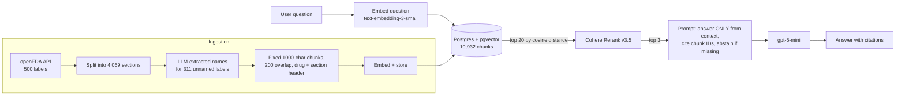

# Pharma RAG: Question Answering over FDA Drug Labels


A retrieval-augmented generation (RAG) system that answers questions about prescription and OTC drugs using FDA drug labels, with every claim cited to its source chunk. Built and evaluated end to end: every design choice below was tested against a 101-question, hand-reviewed golden dataset and kept or rejected on measured results.

**Shipped configuration:** fixed-size chunking → OpenAI embeddings in pgvector → top-20 vector candidates → Cohere Rerank → top 3 chunks → `gpt-5-mini` answer with chunk citations and abstention.

| Metric (shipped config, 101-question set) | Result |
|---|---|
| Retrieval recall@5 | **0.99** |
| Retrieval MRR | **0.88** |
| Answer faithfulness (LLM judge) | **0.91** |
| Answer correctness (LLM judge) | **0.93** full, 0.07 partial, **0 wrong** |
| Abstention on unanswerable questions | **10/10** |
| Judge agreement with a second, cross-family judge | **100%** faithfulness, **98%** correctness |
| Median latency | **5.1 s** |
| Cost per query | **~$0.00085** |

---

## Architecture



## Stack

| Layer | Choice | Why |
|---|---|---|
| Data | openFDA drug label API | Real, messy regulatory text; free |
| Vector store | PostgreSQL 17 + pgvector (Docker) | SQL joins between vectors and metadata, one database, no extra service at this scale |
| Embeddings | OpenAI `text-embedding-3-small` | Cheap (~$0.07 to embed the corpus), strong quality |
| Reranker | Cohere `rerank-v3.5` | Standard production reranker; also available on AWS Bedrock and Azure |
| Generator | `gpt-5-mini` | Low cost per query |
| Judge | `gpt-5` | A different, stronger model than the generator, to avoid self-preference bias |

---

## Data pipeline

1. **Fetch:** 500 labels from the openFDA drug label API.
2. **Sectionise:** keep 19 useful sections (indications, warnings, adverse reactions, dosing, interactions and so on); drop IDs, package text and HTML tables. Result: **4,069 sections**.
3. **Fix missing names:** **311 of 500 labels (62%) had no drug name** in the openFDA metadata. Names were extracted with an LLM from the product-data field, cached, and written back in place without changing any IDs.
4. **Chunk:** fixed 1,000-character chunks with 200 overlap. Every chunk starts with `Drug: X | Section: Y` so it carries its own context. Result: **10,932 chunks**.
5. **Embed and store** in pgvector. Embedding is resumable: it commits after every batch and skips chunks that are already embedded.

## Evaluation design

**Golden dataset: 101 questions across about 60 drugs**

| Type | Count | How it was built |
|---|---|---|
| Factual / numeric | 64 | 2 handwritten; 62 LLM-drafted from randomly sampled sections across 13 section types, every one **reviewed**: 13 rewritten to remove wording copied from the label or leaked answers, 3 deleted as unrealistic or unscoreable |
| Hard variants | 27 | Misspellings, lay wording, multi-part, comparisons, built from existing questions so the correct section is known |
| Unanswerable | 10 | Price, stock, reviews, insurance, company facts (never in drug labels) |

The second batch of 56 questions used **only drugs not in the first 45**, so it works as a held-out test of choices made on the first batch.

**Retrieval metrics:** recall@1, recall@5, MRR. Relevance is defined at **section level** (generic name + section type), not chunk level, so one golden set can score any chunking strategy, and duplicate labels from different manufacturers count correctly.

**Answer metrics:** faithfulness (every claim supported by the retrieved context) and correctness (yes/partial/no against the reference) from an LLM judge. Abstention is checked with plain code, not an LLM, because a rule can decide it. Every run (retrieval and answers) is saved per question with a timestamp in `eval/runs/` for regression diffs.

**Judge validation:** a second judge from a different model family (Claude) labelled all 41 answerable questions of one run independently. Agreement: **41/41 on faithfulness, 40/41 on correctness**. Labels are in `eval/judge2_labels.jsonl`.

---

## Results

### Final numbers (101 questions)

| Config | R@1 | R@5 | MRR | Hard-question MRR | Misspelling MRR |
|---|---|---|---|---|---|
| Vector only | 0.74 | 0.95 | 0.82 | 0.76 | 0.58 |
| **Vector top-20 → Cohere rerank (shipped)** | **0.81** | **0.99** | **0.88** | **0.88** | **0.92** |

| Config | Faithful | Correct | Partial | Abstention | Median latency | Cost/query |
|---|---|---|---|---|---|---|
| **Rerank, k=3 (shipped)** | **0.91** | **0.93** | 0.07 | **10/10** | 5.1 s | $0.00085 |

### Development experiments (first 45 questions)

These were run while building, on the first 45 questions. Every decision was made here; the 101-question numbers above are the honest check.

**Retrieval (41 answerable, k=5)**

| Change | R@1 | R@5 | MRR | Decision |
|---|---|---|---|---|
| Vector, fixed chunks (before name fix) | 0.83 | 0.98 | 0.89 | baseline |
| Vector, recursive chunks (before name fix) | 0.68 | 0.93 | 0.79 | |
| Vector, fixed chunks (after name fix) | 0.85 | 0.98 | 0.91 | **kept** |
| Vector, recursive chunks (after name fix) | 0.78 | 0.95 | 0.86 | rejected |
| Hybrid: Postgres `ts_rank` + vector (RRF) | 0.54 | 0.83 | 0.64 | rejected |
| Hybrid: BM25 + vector (RRF, keyword weight 1.0) | 0.59 | 0.90 | 0.71 | rejected |
| Hybrid: BM25 + vector (RRF, keyword weight 0.3) | 0.73 | 0.93 | 0.81 | rejected |
| **Vector top-20 → Cohere rerank** | **0.90** | **1.00** | **0.94** | **kept** |

**Answers (45 questions)**

| Config | Faithful | Correct | Partial | Median latency | Cost/query |
|---|---|---|---|---|---|
| Vector, k=5 | 0.95 | 0.93 | 0.07 | 5.6 s | $0.00102 |
| Rerank, k=5 | 0.93 | 0.88 | 0.12 | 6.5 s | $0.00102 |
| **Rerank, k=3** | **0.95** | **0.95** | **0.05** | **5.2 s** | **$0.00084** |
| Rerank, k=3 + neighbour expansion | 0.90 | 0.88 | 0.10 | 3.9 s* | $0.00105 |
| Rerank, k=3 (identical re-run, 6 days later) | 0.90 | 0.95 | 0.05 | 5.0 s | $0.00079 |

*Latency is not comparable across runs made at different times; API response time varies with load.

---

## Key findings

**1. The biggest gain came from fixing the data, not the algorithm.** 62% of labels had no drug name, so most chunks were headed `Drug: unknown`. Extracting names with an LLM lifted MRR from 0.89 to 0.91 with no change to retrieval.

**2. Half of an apparent regression was a measurement bug.** Recursive chunking first looked 10 MRR points worse. Inspecting the misses showed the retrieved chunks were *correct*: they came from a duplicate label with no name, which the relevance check couldn't match. After fixing the data and switching relevance to generic name + section, the gap halved. Recursive still lost by 5 points, likely because sentence-only overlap left many chunks with none.

**3. Hybrid search hurt on this data.** Postgres `ts_rank` has no IDF, so common words like "take" dominated, and MRR fell to 0.64. Real BM25 recovered to 0.71, and down-weighting keywords to 0.81, but none beat vector-only (0.91). The drug-name header already gave vector search the exact-match signal BM25 normally adds.

**4. The reranker paid off in cost first, then in robustness.** At k=5 it improved retrieval but not answers, because the right chunk was already in context. At k=3 it held answer quality with 40% fewer input tokens: **18% lower cost** and lower median latency despite the extra API call. Cost fell 18% rather than 40% because output and reasoning tokens dominate `gpt-5-mini` spend. On the full set its value is clearer: **MRR +0.06**, and misspelled questions from **0.58 to 0.92**.

**5. The first 45 questions had become a dev set.** Every decision was made looking at them. On 56 new questions about unseen drugs, vector MRR fell from 0.91 to 0.82. The reranker's gain held up on the new questions, which is what makes it a real improvement rather than a fit to the original set.

**6. Run-to-run noise is about 0.05, measured.** The identical config scored faithfulness 0.95 and then 0.90 six days apart. Differences smaller than that aren't conclusions. That changed one finding: neighbour-chunk expansion (adding the chunks either side of each hit) fixed the specific gap that motivated it, but its overall faithfulness was within noise, and it cost 25% more, so it was kept off for **no measurable gain**, not because it was proven worse. Decisions now rest on questions that fail consistently across runs, not on averages.

**7. The judge was validated, and its failures point at one fix.** A second judge from a different model family agreed on every faithfulness verdict. Every unfaithful answer is an **embellishment** (an added mechanism, added advice, a misattribution), never a fabricated dose or contraindication. Q3, Q6 and Q38 were flagged in three separate runs. That points to a specific prompt fix: forbid explanations or advice that aren't in the context.

---

## Limitations

- **Single-section relevance.** Some questions are answered equally well by two sections (e.g. contraindications vs drug interactions), so ranking metrics are slightly pessimistic.
- **Judge validated by a second model, not by humans.** Cross-family agreement is high, but both judges could share a blind spot.
- **No ANN index.** Exact cosine scan is fast at about 11k vectors; at millions, an HNSW index would be needed.
- **Trial rerank key.** Rate-limited (about 10 calls/min), so a throttle is built in. Set `RERANK_MIN_GAP=0` with a production key.
- **BM25 without stemming**, so "contraindicated" and "contraindications" don't match.

---

## Deployment and operations

### API (FastAPI)

| Endpoint | Auth | What it does |
|---|---|---|
| `GET /health` | none | Liveness check for Docker and load balancers |
| `POST /ask` | `X-API-Key` | Answer with cited sources, latency and token counts |
| `POST /ask/stream` | `X-API-Key` | Same answer streamed token by token (Server-Sent Events) |

- **API-key auth:** requests without the key get a 401, so a leaked URL can't run up the LLM bill.
- **Rate limiting:** 10 requests/minute per caller (`slowapi`); extra requests get a 429.
- **Input validation:** questions must be 3–500 characters, rejected before any LLM call.

### Container

- **Multi-stage Dockerfile:** dependencies install in a build stage; the runtime image carries only the installed packages and the code (**101 MB**).
- **API-only requirements** (9 pinned packages): eval tooling such as RAGAS and LangChain stays out of the production image.
- **Runs as a non-root user**, with a Docker `HEALTHCHECK` on `/health`.
- **No secrets in the image:** `.dockerignore` excludes `.env`; keys are injected at runtime.

### Docker Compose

`docker compose up -d` starts Postgres + pgvector and the API together.

- **The database has no host port**, so it is reachable only from the API container, never from outside.
- The API waits for the database to report **healthy** before starting.
- **Data migration:** the vector database moves between environments with `pg_dump` / `pg_restore` (custom format), verified by chunk counts after restore.
- `restart: unless-stopped` brings both services back after a crash or a reboot.

### CI (GitHub Actions)

Every push runs two jobs:

1. **The Docker image builds.**
2. **Retrieval smoke eval:** a fresh pgvector service container is loaded from a **12 MB fixture database** (the sections for 15 smoke questions plus 300 random distractor sections, keeping the original IDs), then the real pipeline runs (embeddings → pgvector → Cohere rerank). **The build fails if recall@5 < 0.9** (with 15 questions, one miss passes and two fail). Per-question results are uploaded as an artifact even when the run fails.

The fixture is restored with the same `pgvector:pg17` image that created it, because the runner's own `pg_restore` is older and can't read Postgres 17 dumps.

### Hosting

Designed for a single EC2 instance (t3.small, 2 GB RAM) running Docker Compose, with only the API port open. For production scale: ECS Fargate for the API, RDS for PostgreSQL with pgvector, and HTTPS through an ALB with an ACM certificate. This demo serves plain HTTP, so the API key travels unencrypted.

---

## Run it

**Requirements:** Python 3.12, Docker, an OpenAI API key, a Cohere API key.

```bash
# 1. Postgres + pgvector
docker run -d --name pharma-pg -e POSTGRES_USER=rag -e POSTGRES_PASSWORD=rag \
  -e POSTGRES_DB=pharma -p 5434:5432 -v pharma_pgdata:/var/lib/postgresql/data \
  pgvector/pgvector:pg17
docker exec -it pharma-pg psql -U rag -d pharma -c "CREATE EXTENSION IF NOT EXISTS vector;"

# 2. Python environment
python -m venv .venv
pip install -r requirements.txt

# 3. Keys in .env
#    OPENAI_API_KEY=...
#    COHERE_API_KEY=...

# 4. Ingest
python src/fetch_labels.py
python src/load_sections.py
python src/extract_names.py
python src/apply_names.py
python src/chunk_fixed.py
python src/embed_chunks.py

# 5. Ask a question
python src/answer.py "Can I take trazodone with an MAOI antidepressant?"

# 6. Evaluate
python src/eval_retrieval.py
python src/eval_answers.py
```

**Or run the API with Docker Compose** (needs `API_KEY` and `DB_PASSWORD` in `.env`, plus a dump in `data/pharma.dump`):

```bash
docker compose up -d --build
docker compose cp data/pharma.dump db:/tmp/pharma.dump
docker compose exec db pg_restore -U rag -d pharma --no-owner /tmp/pharma.dump
python src/stream_test.py "Can I take trazodone with an MAOI?"
```

**Configuration (environment variables)**

| Variable | Default | Options |
|---|---|---|
| `RAG_STRATEGY` | `fixed_1000_200` | `recursive_1000_200` |
| `RAG_SEARCH` | `vector` | `hybrid`, `bm25_hybrid` |
| `RAG_RERANK` | `cohere` | `none` |
| `RAG_K` | `3` | number of chunks sent to the LLM |
| `RAG_NEIGHBOURS` | `0` | `1` to add ±1 neighbour chunks |

## Repository layout

```
src/
  fetch_labels.py        openFDA download
  load_sections.py       labels -> sections table
  extract_names.py       LLM name extraction for unnamed labels (cached)
  apply_names.py         in-place name + generic-name update
  chunk_fixed.py         fixed-size chunking
  chunk_recursive.py     recursive chunking (tested, not shipped)
  embed_chunks.py        resumable batch embedding
  search.py              vector / hybrid / BM25-hybrid search + Cohere rerank
  answer.py              prompt, generation, optional neighbour expansion
  make_golden.py         first batch of LLM-drafted golden questions
  make_golden_more.py    second batch, unseen drugs only
  apply_review.py        review edits for batch 1
  apply_review2.py       review edits, hard variants, unanswerable for batch 2
  add_hard.py            hard variants for batch 1
  eval_retrieval.py      recall@k and MRR by question type, saved per run
  eval_answers.py        LLM-judge faithfulness/correctness, cost, latency, saved per run
  label.py               blind labelling tool for judge validation
  api.py                 FastAPI app: /health, /ask, /ask/stream, API key, rate limit
  stream_test.py         streaming client (set RAG_URL to test a deployed server)
  make_smoke_fixture.py  builds the CI fixture database and smoke question set
Dockerfile               multi-stage, non-root, healthcheck
docker-compose.yml       pgvector + API, internal-only database
requirements-api.txt     the 9 pinned packages the API image needs
.github/workflows/ci.yml Docker build + retrieval smoke eval gate
tests/fixtures/
  smoke.dump             12 MB fixture database for CI
eval/
  golden.jsonl           101-question golden set
  smoke.jsonl            15-question subset used by CI
  golden_draft*.jsonl    original LLM drafts (kept for provenance)
  judge2_labels.jsonl    second-judge labels
  runs/                  timestamped per-question retrieval and answer evals
  RESULTS.md             running results log
```

## Next

- Test the anti-embellishment prompt fix against the questions flagged in every run.
- Run RAGAS alongside the custom judge and compare where they disagree.
- Expose `search()` as an MCP tool for a LangGraph agent (Project 3).
