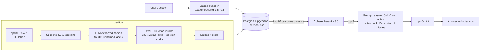

# Pharma RAG: Question Answering over FDA Drug Labels

A retrieval-augmented generation (RAG) system that answers questions about prescription and OTC drugs using FDA drug labels, with every claim cited to its source chunk. Built and evaluated end to end: every design choice below was tested against a hand-reviewed golden dataset and kept or rejected on measured results.

**Shipped configuration:** fixed-size chunking → OpenAI embeddings in pgvector → top-20 vector candidates → Cohere Rerank → top 3 chunks → `gpt-5-mini` answer with chunk citations and abstention.

| Metric (shipped config) | Result |
|---|---|
| Retrieval recall@5 | **1.00** |
| Retrieval MRR | **0.94** |
| Answer faithfulness (LLM judge) | **0.95** |
| Answer correctness (LLM judge) | **0.95** |
| Abstention on unanswerable questions | **4/4** |
| Median latency | **5.2 s** |
| Cost per query | **~$0.0008** |

---

## Architecture



## Stack

| Layer | Choice | Why |
|---|---|---|
| Data | openFDA drug label API | Real, messy regulatory text; free |
| Vector store | PostgreSQL 17 + pgvector (Docker) | SQL joins between vectors and metadata, one database, no extra service at this scale |
| Embeddings | OpenAI `text-embedding-3-small` | Cheap (~$0.07 to embed the corpus), strong quality |
| Reranker | Cohere `rerank-v3.5` | Standard production reranker; also available on AWS Bedrock and Azure |
| Generator | `gpt-5-mini` | Low cost per query |
| Judge | `gpt-5` | A different, stronger model than the generator, to avoid self-preference bias |

---

## Data pipeline

1. **Fetch:** 500 labels from the openFDA drug label API.
2. **Sectionise:** keep 19 useful sections (indications, warnings, adverse reactions, dosing, interactions and so on); drop IDs, package text and HTML tables. Result: **4,069 sections**.
3. **Fix missing names:** **311 of 500 labels (62%) had no drug name** in the openFDA metadata. Names were extracted with an LLM from the product-data field, cached, and written back in place without changing any IDs.
4. **Chunk:** fixed 1,000-character chunks with 200 overlap. Every chunk starts with `Drug: X | Section: Y` so it carries its own context. Result: **10,932 chunks**.
5. **Embed and store** in pgvector. Embedding is resumable: it commits after every batch and skips chunks that are already embedded.

## Evaluation design

**Golden dataset: 45 questions**

| Type | Count | How it was built |
|---|---|---|
| Factual / numeric | 26 | 2 handwritten; 24 LLM-drafted from randomly sampled sections (2 per section type), then **human-reviewed**: 8 rewritten to remove copied label wording, 2 deleted as unrealistic |
| Hard variants | 15 | Misspellings, lay wording, multi-part, comparisons, built from existing questions so the correct section is known |
| Unanswerable | 4 | Price, pharmacy stock, reviews, company leadership (never in drug labels) |

**Retrieval metrics:** recall@1, recall@5, MRR. Relevance is defined at **section level** (generic name + section type), not chunk level, so one golden set can score any chunking strategy, and duplicate labels from different manufacturers count correctly.

**Answer metrics:** faithfulness (every claim supported by the retrieved context) and correctness (yes/partial/no against the reference) from an LLM judge. Abstention is checked with plain code, not an LLM, because a rule can decide it. Every run is saved per question with a timestamp in `eval/runs/` for regression diffs.

---

## Results

### Retrieval (41 answerable questions, k=5)

| Change | R@1 | R@5 | MRR | Decision |
|---|---|---|---|---|
| Vector, fixed chunks (before name fix) | 0.83 | 0.98 | 0.89 | baseline |
| Vector, recursive chunks (before name fix) | 0.68 | 0.93 | 0.79 | |
| Vector, fixed chunks (after name fix) | 0.85 | 0.98 | 0.91 | **kept** |
| Vector, recursive chunks (after name fix) | 0.78 | 0.95 | 0.86 | rejected |
| Hybrid: Postgres `ts_rank` + vector (RRF) | 0.54 | 0.83 | 0.64 | rejected |
| Hybrid: BM25 + vector (RRF, keyword weight 1.0) | 0.59 | 0.90 | 0.71 | rejected |
| Hybrid: BM25 + vector (RRF, keyword weight 0.3) | 0.73 | 0.93 | 0.81 | rejected |
| **Vector top-20 → Cohere rerank** | **0.90** | **1.00** | **0.94** | **kept** |

On hard questions alone, the reranker moved R@1 from 0.87 to **1.00**, and on misspellings from 0.60 to **1.00**.

### Answers (45 questions)

| Config | Faithful | Correct | Partial | Median latency | Cost/query |
|---|---|---|---|---|---|
| Vector, k=5 | 0.95 | 0.93 | 0.07 | 5.6 s | $0.00102 |
| Rerank, k=5 | 0.93 | 0.88 | 0.12 | 6.5 s | $0.00102 |
| **Rerank, k=3 (shipped)** | **0.95** | **0.95** | **0.05** | **5.2 s** | **$0.00084** |
| Rerank, k=3 + neighbour expansion | 0.90 | 0.88 | 0.10 | 3.9 s* | $0.00105 |

All configurations abstained correctly on 4/4 unanswerable questions.
*Latency is not comparable across runs made at different times; API response time varies with load.

---

## Key findings

**1. The biggest gain came from fixing the data, not the algorithm.** 62% of labels had no drug name, so most chunks were headed `Drug: unknown`. Extracting names with an LLM lifted MRR from 0.89 to 0.91 with no change to retrieval.

**2. Half of an apparent regression was a measurement bug.** Recursive chunking first looked 10 MRR points worse. Inspecting the misses showed the retrieved chunks were *correct*: they came from a duplicate label with no name, which the relevance check couldn't match. After fixing the data and switching relevance to generic name + section, the gap halved. Recursive still lost by 5 points, likely because sentence-only overlap left many chunks with none.

**3. Hybrid search hurt on this data.** Postgres `ts_rank` has no IDF, so common words like "take" dominated, and MRR fell to 0.64. Real BM25 recovered to 0.71, and down-weighting keywords to 0.81, but none beat vector-only (0.91). The drug-name header already gave vector search the exact-match signal BM25 normally adds.

**4. The reranker's value showed up in cost, not accuracy.** At k=5 it improved retrieval but not answers, because the right chunk was already in context. At k=3 it held answer quality with 40% fewer input tokens: **18% lower cost** and lower median latency despite the extra API call. Cost fell 18% rather than 40% because output and reasoning tokens dominate `gpt-5-mini` spend.

**5. Fixing one example made the average worse.** The judge flagged a true but ungrounded claim ("tardive dyskinesia may be irreversible"). SQL showed the fact was in chunk 5618, between two retrieved chunks (5617 and 5619): the model had filled the gap from memory. Neighbour expansion fixed that case, but across the set faithfulness fell from 0.95 to 0.90 and cost rose 25%. About 3× more context led to embellishment, and one answer lost in the middle. It was kept off.

**6. The judge was checked, not trusted.** Its unfaithful verdict above was verified by hand against the source chunks in SQL.

---

## Limitations

- **Small eval set.** At 45 questions, run-to-run noise is about 1–2 questions (0.02–0.05); smaller differences are not conclusions.
- **Single-section relevance.** Some questions are answered equally well by two sections (e.g. contraindications vs drug interactions), so ranking metrics are slightly pessimistic.
- **Judge not formally validated.** It was spot-checked, but there's no measured agreement rate against human labels yet.
- **No ANN index.** Exact cosine scan is fast at about 11k vectors; at millions, an HNSW index would be needed.
- **Trial rerank key.** Rate-limited (about 10 calls/min), so a throttle is built in. Set `RERANK_MIN_GAP=0` with a production key.
- **BM25 without stemming**, so "contraindicated" and "contraindications" don't match.

---

## Run it

**Requirements:** Python 3.12, Docker, an OpenAI API key, a Cohere API key.

```bash
# 1. Postgres + pgvector
docker run -d --name pharma-pg -e POSTGRES_USER=rag -e POSTGRES_PASSWORD=rag \
  -e POSTGRES_DB=pharma -p 5434:5432 -v pharma_pgdata:/var/lib/postgresql/data \
  pgvector/pgvector:pg17
docker exec -it pharma-pg psql -U rag -d pharma -c "CREATE EXTENSION IF NOT EXISTS vector;"

# 2. Python environment
python -m venv .venv
pip install -r requirements.txt

# 3. Keys in .env
#    OPENAI_API_KEY=...
#    COHERE_API_KEY=...

# 4. Ingest
python src/fetch_labels.py
python src/load_sections.py
python src/extract_names.py
python src/apply_names.py
python src/chunk_fixed.py
python src/embed_chunks.py

# 5. Ask a question
python src/answer.py "Can I take trazodone with an MAOI antidepressant?"

# 6. Evaluate
python src/eval_retrieval.py
python src/eval_answers.py
```

**Configuration (environment variables)**

| Variable | Default | Options |
|---|---|---|
| `RAG_STRATEGY` | `fixed_1000_200` | `recursive_1000_200` |
| `RAG_SEARCH` | `vector` | `hybrid`, `bm25_hybrid` |
| `RAG_RERANK` | `cohere` | `none` |
| `RAG_K` | `3` | number of chunks sent to the LLM |
| `RAG_NEIGHBOURS` | `0` | `1` to add ±1 neighbour chunks |

## Repository layout

```
src/
  fetch_labels.py      openFDA download
  load_sections.py     labels -> sections table
  extract_names.py     LLM name extraction for unnamed labels (cached)
  apply_names.py       in-place name + generic-name update
  chunk_fixed.py       fixed-size chunking
  chunk_recursive.py   recursive chunking (tested, not shipped)
  embed_chunks.py      resumable batch embedding
  search.py            vector / hybrid / BM25-hybrid search + Cohere rerank
  answer.py            prompt, generation, optional neighbour expansion
  make_golden.py       LLM-drafted golden questions
  apply_review.py      human review edits -> golden set
  add_hard.py          hard question variants
  eval_retrieval.py    recall@k and MRR, split by question type
  eval_answers.py      LLM-judge faithfulness/correctness, cost, latency
eval/
  golden.jsonl         45-question golden set
  golden_draft.jsonl   original LLM drafts (kept for provenance)
  runs/                timestamped per-question answer evals
  RESULTS.md           running results log
```

## Next

- Grow the golden set toward 100 questions and add a human-labelled agreement check for the judge.
- Run RAGAS alongside the custom judge and compare where they disagree.
- Expose `search()` as an MCP tool for a LangGraph agent (Project 3).
